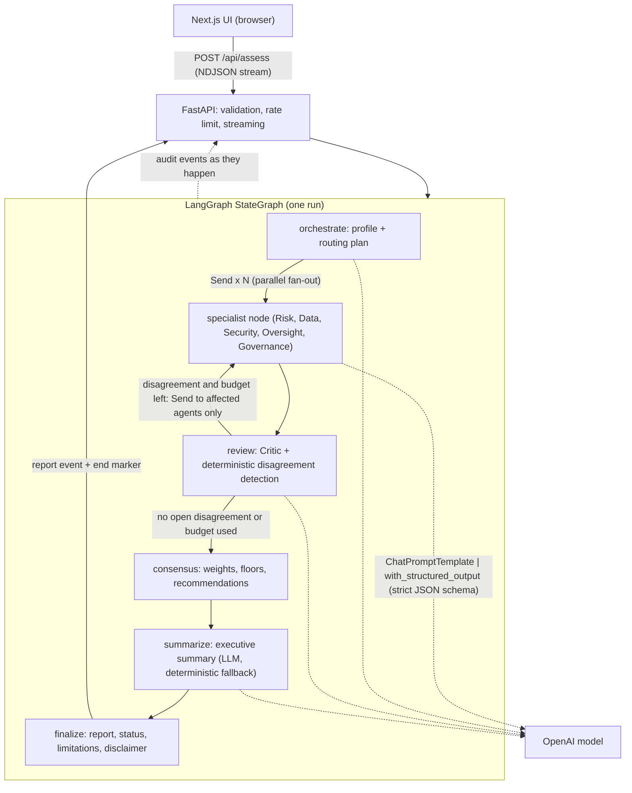

# EUROPA AI GOVERNANCE

**Multi-Agent AI Governance & Risk Intelligence Platform**

Describe an AI system. Specialist agents assess risk, data governance, security, human oversight and EU regulatory concepts in parallel. A critic audits their work, disagreements are detected and reassessed, and a deterministic consensus produces a structured, auditable report.

> This tool provides AI-assisted governance analysis for informational purposes and does not constitute legal advice, regulatory certification, or a formal compliance determination.

This is a portfolio project by Shahil. It is not a chatbot: every agent returns a validated, typed object, and the report is assembled by code, not by a model.

## What it does

- Takes a free-text AI system description (30 to 6000 characters) or one of 7 demo scenarios.
- An **Orchestrator** profiles the system and routes work to five specialists.
- **Risk, Data Governance, Security, Human Oversight and Governance** agents run concurrently.
- A **Critic** looks for contradictions, unsupported claims and miscalibrated confidence.
- Deterministic code detects **disagreements** between agents and, within a hard budget of 1 or 2 rounds, sends only the affected agents back for reassessment with the conflicting view as context.
- A deterministic **consensus** (weights, confidence, precautionary floors) sets the overall level. The model writes only the executive summary.
- The UI shows the agent network and audit trail **live**, from real backend events.

## Architecture



Graph, as implemented in `backend/europa/graph.py`: `START -> orchestrate -> specialist (xN, parallel) -> review -> (specialist | consensus) -> summarize -> finalize -> END`.

### Why multi-agent, and why LangGraph

A governance review is several different questions asked of one system: harm, data, security, oversight, regulatory fit. Separate agents with separate prompts and separate output schemas keep each question focused and let them run in parallel. Their disagreement is itself a result worth showing, so it is detected, recorded and acted on instead of averaged away.

LangGraph is used for what it is good at here, not as decoration:

- a typed shared state with merge reducers, so parallel specialists can write results safely;
- `Send` for dynamic parallel fan-out, including a targeted second fan-out to only the agents in disagreement;
- conditional edges for the bounded critic and reassessment loop;
- a per-run context passed through `config["configurable"]`, so concurrent requests never share state.

### Why LangChain and Pydantic

Each agent is `ChatPromptTemplate | ChatOpenAI.with_structured_output(Schema, method="json_schema", strict=True)`. The Pydantic v2 schemas (`extra="forbid"`) are the contract between model, graph, API and UI. Validators enforce hedged wording, force `requires_legal_review` to true, validate routing and bound every list and string. The input model strips control characters and enforces size limits.

### Critic, disagreement and reassessment

1. Specialists produce structured assessments.
2. The Critic returns issues, requested reassessments and confidence adjustments.
3. Deterministic rules add disagreements from levels (for example a spread of 2 or more steps, or a security outlier) and from critic issues of medium severity or higher.
4. If anything is open and rounds remain (default 1, hard maximum 2), only the named agents are re-run with the conflicting view in a `<reassessment>` block. The Critic then reviews again.
5. Every disagreement stays in the report with a status: `RESOLVED`, `UNRESOLVED` or `OPEN`, with the round it was detected in. Nothing is silently dropped.

### State management

The service is stateless: no database, no sessions, no stored reports. One graph run owns one `GraphState`. The audit trail is an in-memory, append-only list per run, streamed to the client as it is written. The browser keeps run state in a pure reducer (`frontend/src/lib/state.ts`) that derives agent status only from backend events.

### Malformed output and failure handling

| Situation | Behaviour |
| --- | --- |
| Model output fails schema validation | One retry with the validation error as feedback, then the agent is marked `FAILED` |
| One specialist fails | Report status `PARTIAL`; remaining agents still count; limitation listed |
| All specialists fail | Report status `FAILED` |
| Orchestrator fails | Deterministic fallback profile and full routing |
| Critic fails | Report `PARTIAL`; deterministic disagreement detection continues |
| Reassessment fails | The earlier result is kept |
| Summary fails | Deterministic summary from the consensus |
| Run exceeds the deadline (240 s) | Terminal `error` event with a generic message |
| Stream ends without a report | UI shows a clear error (`report_lost` or `interrupted`), never an infinite loader |

### Avoiding legal advice

The disclaimer is shown in the hero footer, the report and the API payload. Prompts instruct hedged language ("appears", "may", "potentially"), forbid asserting legal fact and forbid certifying compliance. A schema validator rejects assertive phrasing. The report always carries `requires_legal_review = true`. The knowledge base lists regulatory concepts (EU AI Act risk tiers, GDPR automated decision-making, and similar) as general concepts for orientation, not as legal text.

## API

| Method | Path | Notes |
| --- | --- | --- |
| `GET` | `/api/health` | Status, model name, whether a key is configured. The key is never returned |
| `GET` | `/api/scenarios` | The 7 demo scenarios |
| `POST` | `/api/assess` | Body `{"description": "...", "scenario_id": "optional"}`. Responds with `application/x-ndjson` |

Stream lines: `{"type":"audit","event":{...}}`, `{"type":"ping"}` (heartbeat every 8 s), then exactly one terminal `{"type":"report","report":{...}}` or `{"type":"error","error":{...}}`, followed by `{"type":"end"}` and 2 KB of newline padding to push proxy buffers.

Errors use `{"error":{"code","message"}}`: `413`, `415`, `400`, `422 validation_error`, `429 rate_limited` (with `Retry-After`), `503 not_configured`, `503 busy`. Internal errors are generic and never include stack traces.

## Tech stack

- **Backend:** Python 3.13, FastAPI, LangChain (core + OpenAI), LangGraph, Pydantic v2, asyncio, OpenAI (default `gpt-4.1-mini`).
- **Frontend:** Next.js 16 App Router, TypeScript, Tailwind CSS v4.
- **Tests:** pytest, ruff, ESLint, `tsc`, vitest + Testing Library.
- No database, no paid services beyond the OpenAI key, no browsing tools.

## Security

- The OpenAI key lives only on the server (`OPENAI_API_KEY`). It is never sent to the browser, logged or committed.
- Input validation and size limits; control characters stripped; request body capped at about 38 KB, enforced before parsing.
- In-memory per-IP sliding-window rate limit (5 runs per 15 minutes by default), a global cap and a concurrency cap. These are best effort per instance, see Limitations.
- CORS restricted to configured origins; security headers (CSP, `X-Content-Type-Options`, `X-Frame-Options`, `Referrer-Policy`, `Permissions-Policy`) on both services.
- Generic client-facing errors. API docs and OpenAPI are disabled.
- User text is placed in the prompt inside delimiters and treated as data. This reduces, but cannot eliminate, prompt injection risk.

## Local setup

Requirements: Python 3.13 (the version tested), Node 20 or newer (tested on 20.19 and, by the author, 24), npm, git.

### Windows PowerShell

```powershell
git clone <this repository>
cd europa-ai-governance

# backend
cd backend
py -3.13 -m venv .venv
.\.venv\Scripts\Activate.ps1
pip install -r requirements.txt -r requirements-dev.txt
Copy-Item ..\.env.example .env       # then edit .env and set OPENAI_API_KEY
uvicorn main:app --port 8000

# frontend (new terminal)
cd europa-ai-governance\frontend
npm install
npm run dev
```

### bash

```bash
git clone <this repository>
cd europa-ai-governance

# backend
cd backend
python3 -m venv .venv && source .venv/bin/activate
pip install -r requirements.txt -r requirements-dev.txt
cp ../.env.example .env              # then edit .env and set OPENAI_API_KEY
uvicorn main:app --port 8000

# frontend (new terminal)
cd europa-ai-governance/frontend
npm install
npm run dev
```

Open <http://localhost:3000>. In development the frontend proxies `/api/*` to `BACKEND_URL` (default `http://127.0.0.1:8000`), so the browser always talks to one origin, as it does in production.

`backend/.env` is gitignored. If `OPENAI_API_KEY` is empty, `POST /api/assess` returns `503 not_configured` and the UI says so.

### Environment variables

| Variable | Default | Purpose |
| --- | --- | --- |
| `OPENAI_API_KEY` | none | Required. Server-side only |
| `OPENAI_MODEL` | `gpt-4.1-mini` | Model for all agents |
| `OPENAI_CRITIC_MODEL` | same as model | Optional stronger critic |
| `OPENAI_TEMPERATURE` | `0.2` | 0 to 1 |
| `CALL_TIMEOUT_SECONDS` | `45` | Per model call |
| `RUN_DEADLINE_SECONDS` | `240` | Whole run (max 280) |
| `MAX_REASSESSMENT_ROUNDS` | `1` | 0 to 2 |
| `RATE_LIMIT_REQUESTS` / `RATE_LIMIT_WINDOW_SECONDS` | `5` / `900` | Per IP |
| `GLOBAL_RATE_LIMIT_REQUESTS` | `60` | Per window |
| `MAX_CONCURRENT_RUNS` | `4` | Per instance |
| `CORS_ALLOW_ORIGINS` | localhost:3000 | Comma separated |
| `BACKEND_URL` | `http://127.0.0.1:8000` | Frontend dev proxy only |

## Testing

No test calls OpenAI. A scripted fake model drives the real graph.

```bash
# backend
cd backend
python -m pytest -q
ruff check .

# frontend
cd frontend
npm run lint
npm run typecheck
npm test
npm run build
```

Backend tests cover schemas and wording guards, guardrails, deterministic disagreement and consensus logic, the graph (parallel fan-out, targeted reassessment, the hard 2-round ceiling, critic-requested reassessment, partial and failed runs, fallbacks), the LangChain adapter (retry, timeout) and the API (validation, limits, rate limit, streaming, end marker). Frontend tests cover the NDJSON parser (split chunks, final line without newline), terminal-event handling (`report_lost`, `interrupted`, stall, cancel), the run reducer, validation and the main components.

An opt-in real-model smoke test is available and prints only statuses and timings:

```bash
cd backend && python scripts/e2e.py
```

UI development without spending tokens: `FAKE_MODE=disagreement uvicorn tests.dev_server:app --port 8000` from `backend/` (modes `happy`, `disagreement`, `partial`).

## Deployment design (Vercel)

One free Vercel Hobby project, Git-connected, using Vercel Services: the Next.js app (`frontend/`) and the FastAPI app (`backend/`, entrypoint `main:app`) in a single deployment, same origin, with `/api/*` routed to the API service. See `vercel.json`. The key is a server-side environment variable on the API service. The stream sets `Cache-Control: no-store`, `X-Accel-Buffering: no`, flushes every event, sends heartbeats and ends with an explicit `end` marker and padding; the client does not depend on the connection closing.

## Limitations

- Rate limits and concurrency caps are in memory, per instance, and reset on cold start. They reduce casual abuse; they are not a hard guarantee of cost control. Set a spend limit on the OpenAI key.
- Output quality depends on the description and the model. The agents cannot see the real system, its data or its documentation.
- The regulatory knowledge is a small, general, hand-written set of concepts. It is not current legal text and is not exhaustive.
- Agents are LLM-based and can be wrong or overconfident. The critic and consensus reduce this and do not remove it.
- Reports are not stored. Reloading the page loses the report.
- Prompt injection is mitigated, not solved.

## Future improvements

- Persist reports and allow export (PDF, JSON) with a signed audit trail.
- Retrieval over official regulatory texts with citations.
- A shared rate limiter (for example a managed key-value store) for hard per-user limits.
- Evaluation sets with labelled systems to measure agent agreement and calibration.
- More specialist agents (for example procurement and supply chain).

## Disclaimer

This tool provides AI-assisted governance analysis for informational purposes and does not constitute legal advice, regulatory certification, or a formal compliance determination.

## License

MIT, see `LICENSE`. Portfolio project by Shahil.
