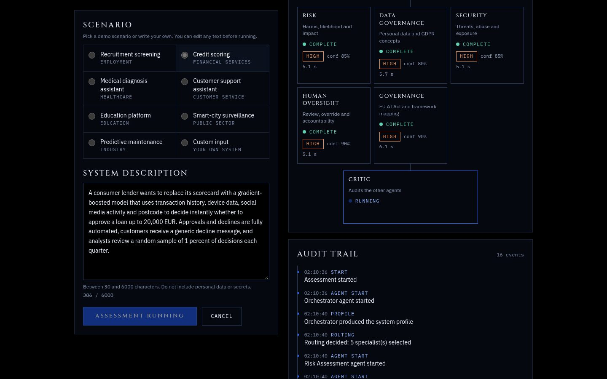
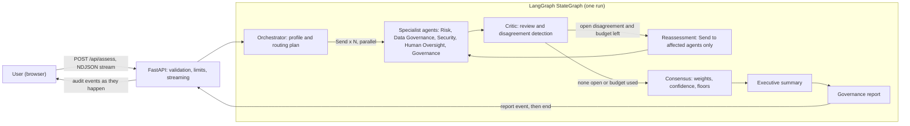

<p align="center">
  
</p>

<h1 align="center">EUROPA AI GOVERNANCE</h1>

<p align="center"><strong>Multi-Agent AI Governance &amp; Risk Intelligence Platform</strong></p>

<p align="center">
  
  
  
  
  
  
  
  
  
  
  <a href="LICENSE"></a>
</p>

<p align="center">
  <a href="https://europa-ai-governance.vercel.app"></a>
</p>

Describe an AI system in plain language. Five specialist agents assess it in parallel, a critic audits their work, disagreements are detected and sent back for reassessment, and deterministic code turns the result into a structured, auditable governance report. You watch the agent network and the audit trail update live while it runs.

<p align="center">
  
</p>

> This tool provides AI-assisted governance analysis for informational purposes and does not constitute legal advice, regulatory certification, or a formal compliance determination.

## Key capabilities

- Free-text input (30 to 6000 characters) or one of 7 demo scenarios.
- An orchestrator profiles the system and routes work to five specialists that run concurrently.
- A critic reviews the specialists for contradictions, unsupported claims and miscalibrated confidence.
- Disagreements are detected by deterministic rules plus the critic, and only the affected agents are re-run, within a hard budget of 1 or 2 rounds.
- Consensus (weights, confidence, precautionary floors) is plain code, not a model. The model writes only the agent findings and the executive summary.
- Every agent returns a validated, typed object. A report is never free-form model text.
- A streamed audit trail built from real backend events, with explicit states for partial and failed runs.

## Architecture



The compiled graph in `backend/europa/graph.py` is `START -> orchestrate -> specialist (xN, parallel) -> review -> (specialist | consensus) -> summarize -> finalize -> END`. The critic and the deterministic disagreement check both live in the `review` node.

### Agent responsibilities

| Agent | Responsibility |
| --- | --- |
| Orchestrator | Builds a system profile and decides which specialists run and with what focus. Falls back to a deterministic plan if it fails |
| Risk | Harms, likelihood and impact |
| Data Governance | Personal data and GDPR concepts |
| Security | Threats, abuse and exposure |
| Human Oversight | Review, override and accountability |
| Governance | EU AI Act and framework mapping |
| Critic | Audits the other agents: contradictions, unsupported claims, confidence calibration, requested reassessments |

### How it works

1. The request is validated by a Pydantic model and rate limited, then the run streams back as NDJSON.
2. The orchestrator profiles the system and the graph fans out to the selected specialists with `Send`.
3. Each specialist is a LangChain chain, `ChatPromptTemplate | ChatOpenAI.with_structured_output(Schema, method="json_schema", strict=True)`. Output that fails validation gets one retry with the error as feedback, then that agent is marked failed.
4. The critic reviews. Deterministic rules add disagreements (for example a spread of two or more risk levels, or a security outlier) and critic issues of medium severity or higher.
5. If anything is open and rounds remain (default 1, hard maximum 2), only the named agents are re-run with the conflicting view in context.
6. Consensus is computed in code. Every disagreement stays in the report with a status of resolved, unresolved or open.
7. The report carries limitations, a status of complete, partial or failed, and a forced `requires_legal_review = true`.

### Why LangGraph, LangChain and Pydantic

- **LangGraph:** typed shared state with merge reducers so parallel specialists write safely, `Send` for dynamic fan-out and a targeted second fan-out, conditional edges for the bounded critic loop, and per-run context in `config["configurable"]` so concurrent requests never share state.
- **LangChain:** prompt templates and structured output binding for every agent call.
- **Pydantic v2:** the contract between model, graph, API and UI (`extra="forbid"`). Validators enforce hedged wording, force `requires_legal_review`, bound lists and strings, and validate routing.

### Failure handling

| Situation | Behaviour |
| --- | --- |
| One specialist fails | Report is `PARTIAL`, the others still count, the limitation is listed |
| All specialists fail | Report is `FAILED` |
| Orchestrator fails | Deterministic profile and full routing |
| Critic fails | Report is `PARTIAL`, deterministic disagreement detection continues |
| Reassessment fails | The earlier result is kept |
| Summary fails | Deterministic summary from the consensus |
| Run exceeds 240 s | Terminal error event with a generic message |
| Stream ends without a report | The UI shows `report_lost` or `interrupted`, never an endless loader |

## Tech stack

| Layer | Technology |
| --- | --- |
| Backend | Python 3.13, FastAPI, LangChain (core and OpenAI), LangGraph, Pydantic v2, asyncio |
| Model | OpenAI, default `gpt-4.1-mini` (`OPENAI_MODEL`, optional `OPENAI_CRITIC_MODEL`) |
| Frontend | Next.js 16 App Router, React 19, TypeScript, Tailwind CSS v4 |
| Tests and checks | pytest, ruff, ESLint, `tsc`, vitest with Testing Library |
| Hosting | Vercel Services: one Git-connected project with the Next.js app and the FastAPI app |

There is no database. The service is stateless and reports are not stored.

## Security

- The OpenAI key is a server-side environment variable only. It is never sent to the browser, logged or committed.
- Input is validated and size limited, control characters are stripped, and the request body is capped before parsing.
- In-memory rate limiting per IP (5 runs per 15 minutes by default), a global cap and a concurrency cap.
- CORS is restricted, a Content Security Policy and standard security headers are set, and API docs are disabled.
- Client-facing errors are generic and never include stack traces.
- User text is placed in the prompt inside delimiters and treated as data. This reduces prompt injection risk and does not remove it.

## Testing

No test calls OpenAI. A scripted fake model drives the real graph.

```bash
# backend
cd backend
python -m pytest -q
ruff check .

# frontend
cd frontend
npm run lint
npm run typecheck
npm test
npm run build
```

At the time of writing: 103 backend tests and 30 frontend tests pass, and lint, type checks and the production build are clean. Backend tests cover the schemas and wording guards, deterministic disagreement and consensus logic, the graph (parallel fan-out, targeted reassessment, the 2-round ceiling, partial and failed runs), the LangChain adapter and the API (limits, rate limit, streaming, end marker). Frontend tests cover the NDJSON parser, terminal-event handling, the run reducer, validation and the main components.

An opt-in smoke test calls the real model and prints only statuses and timings: `cd backend && python scripts/e2e.py`.

## Local development

Requirements: Python 3.13, Node 20 or newer, npm, git.

```bash
git clone https://github.com/shahil5z/europa-ai-governance.git
cd europa-ai-governance

# backend (terminal 1)
cd backend
python3 -m venv .venv && source .venv/bin/activate
pip install -r requirements.txt -r requirements-dev.txt
cp ../.env.example .env        # then set OPENAI_API_KEY in .env
uvicorn main:app --port 8000

# frontend (terminal 2, from the repository root)
cd frontend
npm install
npm run dev
```

On Windows PowerShell, create the environment with `py -3.13 -m venv .venv`, activate it with `.\.venv\Scripts\Activate.ps1` and copy the file with `Copy-Item ..\.env.example .env`. The remaining commands are the same.

Open <http://localhost:3000>. In development the frontend proxies `/api/*` to `BACKEND_URL` (default `http://127.0.0.1:8000`). Without a key, `POST /api/assess` returns `503 not_configured` and the UI says so. To work on the UI without spending tokens, run `FAKE_MODE=disagreement uvicorn tests.dev_server:app --port 8000` from `backend/` (modes `happy`, `disagreement`, `partial`).

### Environment variables

| Variable | Default | Purpose |
| --- | --- | --- |
| `OPENAI_API_KEY` | none | Required. Server-side only |
| `OPENAI_MODEL` | `gpt-4.1-mini` | Model for all agents |
| `OPENAI_CRITIC_MODEL` | same as model | Optional stronger critic |
| `OPENAI_TEMPERATURE` | `0.2` | 0 to 1 |
| `CALL_TIMEOUT_SECONDS` | `45` | Per model call |
| `RUN_DEADLINE_SECONDS` | `240` | Whole run, maximum 280 |
| `MAX_REASSESSMENT_ROUNDS` | `1` | 0 to 2 |
| `RATE_LIMIT_REQUESTS`, `RATE_LIMIT_WINDOW_SECONDS` | `5`, `900` | Per IP |
| `GLOBAL_RATE_LIMIT_REQUESTS` | `60` | Per window |
| `MAX_CONCURRENT_RUNS` | `4` | Per instance |
| `CORS_ALLOW_ORIGINS` | localhost:3000 | Comma separated |
| `BACKEND_URL` | `http://127.0.0.1:8000` | Frontend dev proxy only |
| `NEXT_PUBLIC_SITE_URL` | `http://localhost:3000` | Canonical URL for metadata, Open Graph, robots and sitemap |

Deployment notes are in [docs/DEPLOYMENT.md](docs/DEPLOYMENT.md).

## API

| Method | Path | Notes |
| --- | --- | --- |
| `GET` | `/api/health` | Status and model name. Never returns the key |
| `GET` | `/api/scenarios` | The 7 demo scenarios |
| `POST` | `/api/assess` | Body `{"description": "...", "scenario_id": "optional"}`. Responds with `application/x-ndjson` |

Stream lines are `audit` events, a `ping` heartbeat every 8 s, exactly one terminal `report` or `error`, then `end` followed by 2 KB of newline padding so proxies cannot hold the final line.

## Limitations

- Rate limits and concurrency caps are in memory, per instance, and reset on cold start. They reduce casual abuse and are not a hard cost control. Set a spend limit on the OpenAI key.
- Output depends on the description and the model. The agents cannot see the real system, its data or its documentation.
- The regulatory knowledge is a small, general, hand-written set of concepts. It is not current legal text and is not exhaustive.
- Agents are LLM-based and can be wrong or overconfident. The critic and consensus reduce this and do not remove it.
- Reports are not stored. Reloading the page loses the report.
- Prompt injection is mitigated, not solved.
- Vercel Services is in Beta.
- Browser checks were run with Chrome. Safari and Firefox were not tested.

## AI governance disclaimer

This tool provides AI-assisted governance analysis for informational purposes and does not constitute legal advice, regulatory certification, or a formal compliance determination.

## Future improvements

- Persist reports and allow export (PDF, JSON) with a signed audit trail.
- Retrieval over official regulatory texts with citations.
- A shared rate limiter for hard per-user limits.
- Evaluation sets with labelled systems to measure agent agreement and calibration.
- More specialist agents, for example procurement and supply chain.

## License

MIT. See [LICENSE](LICENSE).

Portfolio project by Shahil
