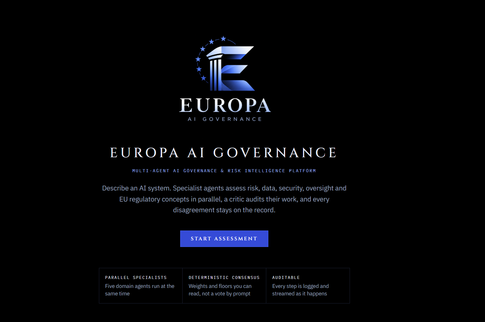
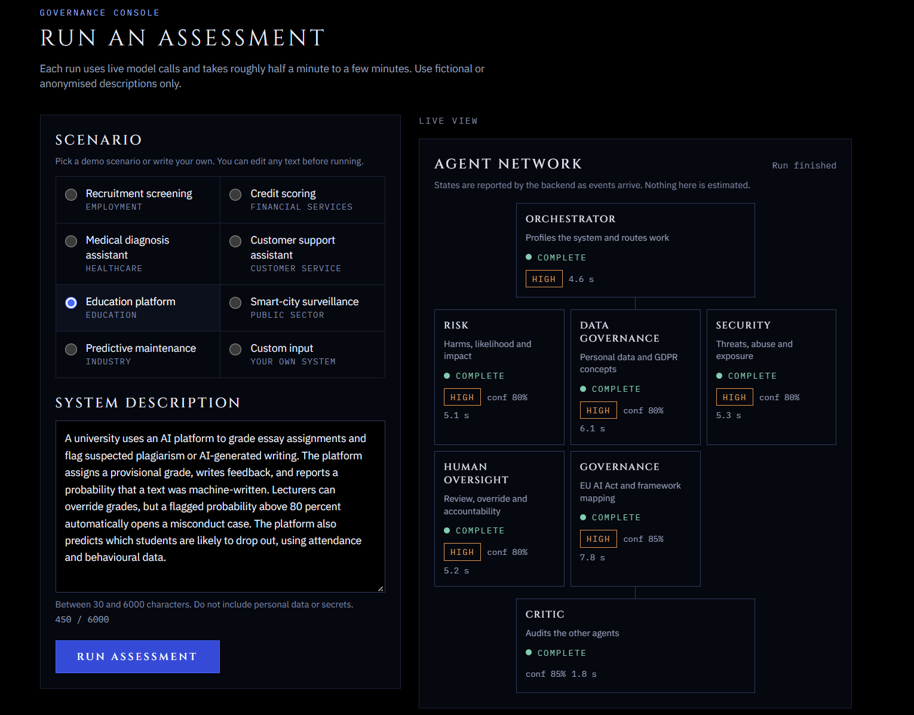
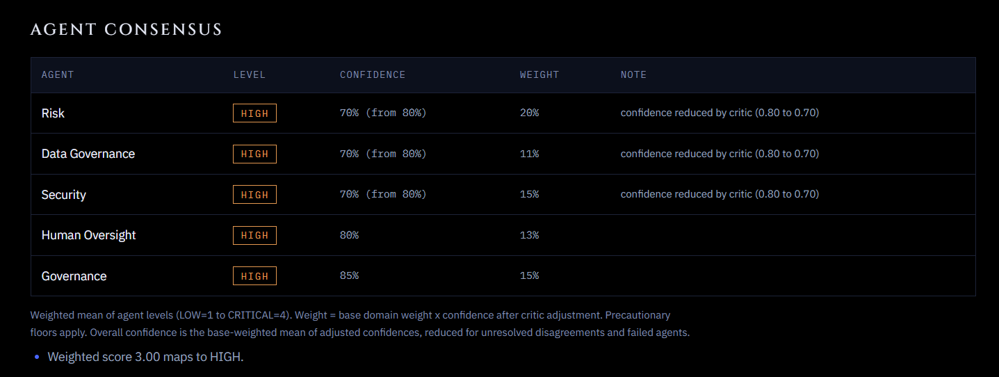
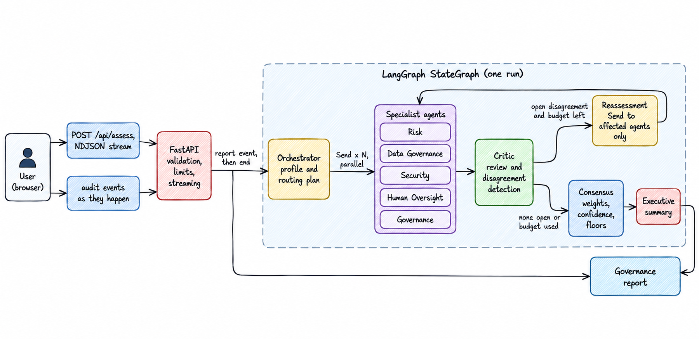

  

<h1 align="center">EUROPA AI GOVERNANCE</h1>

<strong>Multi-Agent AI Governance &amp; Risk Intelligence Platform</strong>

  
  
  
  
  
  
  
  
  
  
  

  

Multi-agent AI governance platform that evaluates AI systems across risk, data governance, security, human oversight, and regulatory considerations, then produces a structured and auditable governance report.

> This tool provides AI-assisted governance analysis for informational purposes and does not constitute legal advice, regulatory certification, or a formal compliance determination.

## Assessment & Agent Consensus

The live assessment interface streams the execution of the multi-agent governance workflow, showing specialist agent states, confidence levels, risk levels, and critic review as the run progresses.

The final **Agent Consensus** view combines the specialist assessments using confidence-adjusted weights to produce a transparent, auditable governance decision with supporting notes and an overall risk level.

## Key capabilities

- Free-text input (30 to 6000 characters) or one of 7 demo scenarios.
- An orchestrator profiles the system and routes work to five specialists that run concurrently.
- A critic reviews the specialists for contradictions, unsupported claims and miscalibrated confidence.
- Disagreements are detected by deterministic rules plus the critic, and only the affected agents are re-run, within a hard budget of 1 or 2 rounds.
- Consensus (weights, confidence, precautionary floors) is plain code, not a model. The model writes only the agent findings and the executive summary.
- Every agent returns a validated, typed object. A report is never free-form model text.
- A streamed audit trail built from real backend events, with explicit states for partial and failed runs.

## Architecture

Specialist agents analyze risk, data governance, security, human oversight, and governance in parallel. A critic reviews their findings and triggers targeted reassessment when needed. The validated results are combined into a confidence-aware governance report.

### Agent responsibilities

| Agent | Responsibility |
| --- | --- |
| Orchestrator | Builds a system profile and decides which specialists run and with what focus. Falls back to a deterministic plan if it fails |
| Risk | Harms, likelihood and impact |
| Data Governance | Personal data and GDPR concepts |
| Security | Threats, abuse and exposure |
| Human Oversight | Review, override and accountability |
| Governance | EU AI Act and framework mapping |
| Critic | Audits the other agents: contradictions, unsupported claims, confidence calibration, requested reassessments |

### How it works

1. **Submit a system**  
   Describe an AI system and its intended use, which is validated before assessment.

2. **Multi-agent assessment**  
   Specialist agents independently evaluate the system across risk, data governance, security, human oversight, and governance.

3. **Critic review**  
   A dedicated critic reviews the findings, identifies inconsistencies or disagreements, and flags areas that need closer examination.

4. **Targeted reassessment**  
   When significant disagreements are found, only the affected agents reassess their findings with the conflicting perspectives in context.

5. **Governance report**  
   The validated findings are combined into a structured, confidence-aware report with identified risks, disagreements, recommendations, limitations, and a required legal review notice.

### Why LangGraph, LangChain and Pydantic

- **LangGraph:** Orchestrates the multi-agent workflow, manages shared state, runs specialists in parallel, and handles targeted reassessment.
- **LangChain:** Powers the agent prompts and structured interactions with the language model.
- **Pydantic:** Validates data and enforces consistent, reliable contracts between the AI agents, backend, and frontend.

### Failure handling

| Situation | Behaviour |
| --- | --- |
| One specialist fails | Report is `PARTIAL`, the others still count, the limitation is listed |
| All specialists fail | Report is `FAILED` |
| Orchestrator fails | Deterministic profile and full routing |
| Critic fails | Report is `PARTIAL`, deterministic disagreement detection continues |
| Reassessment fails | The earlier result is kept |
| Summary fails | Deterministic summary from the consensus |
| Run exceeds 240 s | Terminal error event with a generic message |
| Stream ends without a report | The UI shows `report_lost` or `interrupted`, never an endless loader |

## Tech stack

| Layer | Technology |
| --- | --- |
| Backend | Python 3.13, FastAPI, LangChain (core and OpenAI), LangGraph, Pydantic v2, asyncio |
| Model | OpenAI, default `gpt-4.1-mini` (`OPENAI_MODEL`, optional `OPENAI_CRITIC_MODEL`) |
| Frontend | Next.js 16 App Router, React 19, TypeScript, Tailwind CSS v4 |
| Tests and checks | pytest, ruff, ESLint, `tsc`, vitest with Testing Library |
| Hosting | Vercel Services: one Git-connected project with the Next.js app and the FastAPI app |

There is no database. The service is stateless and reports are not stored.

## Security

- The OpenAI key is a server-side environment variable only. It is never sent to the browser, logged or committed.
- Input is validated and size limited, control characters are stripped, and the request body is capped before parsing.
- In-memory rate limiting per IP (5 runs per 15 minutes by default), a global cap and a concurrency cap.
- CORS is restricted, a Content Security Policy and standard security headers are set, and API docs are disabled.
- Client-facing errors are generic and never include stack traces.
- User text is placed in the prompt inside delimiters and treated as data. This reduces prompt injection risk and does not remove it.

## Limitations

- Rate limits and concurrency caps are in memory, per instance, and reset on cold start. They reduce casual abuse and are not a hard cost control. Set a spend limit on the OpenAI key.
- Output depends on the description and the model. The agents cannot see the real system, its data or its documentation.
- The regulatory knowledge is a small, general, hand-written set of concepts. It is not current legal text and is not exhaustive.
- Agents are LLM-based and can be wrong or overconfident. The critic and consensus reduce this and do not remove it.
- Reports are not stored. Reloading the page loses the report.
- Prompt injection is mitigated, not solved.
- Vercel Services is in Beta.
- Browser checks were run with Chrome. Safari and Firefox were not tested.

## AI governance disclaimer

This tool provides AI-assisted governance analysis for informational purposes and does not constitute legal advice, regulatory certification, or a formal compliance determination.

## Future improvements

- Persist reports and allow export (PDF, JSON) with a signed audit trail.
- Retrieval over official regulatory texts with citations.
- A shared rate limiter for hard per-user limits.
- Evaluation sets with labelled systems to measure agent agreement and calibration.
- More specialist agents, for example procurement and supply chain.

## License

MIT. See [LICENSE](LICENSE).

Portfolio project by Shahil
